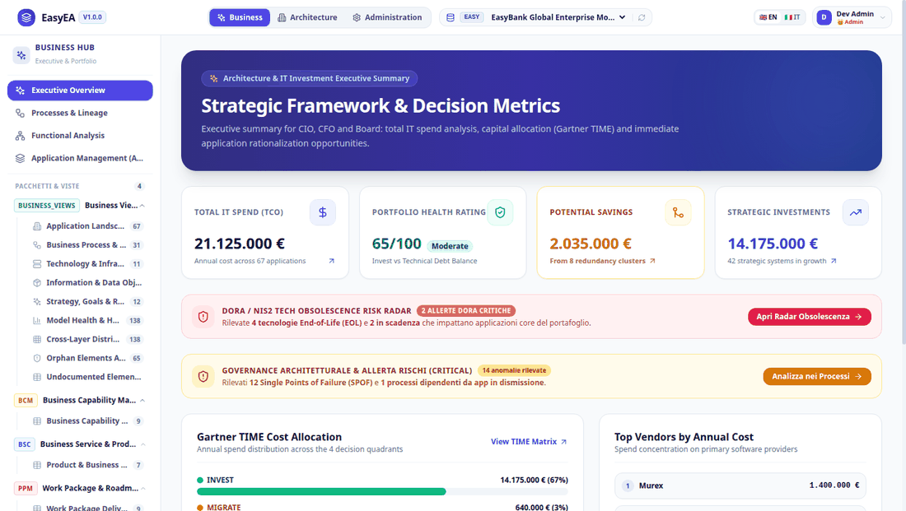

# EasyEA - Business-Oriented Enterprise Architecture Platform

[](https://www.gnu.org/licenses/agpl-3.0)
[](docker-compose.yml)
[](https://fastapi.tiangolo.com)
[](https://react.dev)

<p align="center">
  
</p>

**EasyEA** is a web-based Enterprise Architecture platform designed with two distinct souls:

1. **🏛️ Architect Hub (ArchiMate Core)**: Standard ArchiMate 3.x metamodel, 100% compatible parser with **Archi Tool** (`.archimate` and *Open Group Model Exchange XML*), element and relationship explorer with layer filtering, and interactive graphical diagram viewer powered by React Flow.
2. **💼 Business & Executive Hub**: 
   - **Application Portfolio Management (APM)**: Automated calculation of the Gartner **TIME Matrix** (*Tolerate, Invest, Migrate, Eliminate*), TCO / annual cost tracking, ownership, SLAs, and technology lifecycle status.
   - **Functional Overlap & Gap Analysis**: Dynamic *Capability / Function vs Applications* matrix, redundancy index computation, and estimated cost-saving opportunities to streamline software licensing.
   - **Process Catalog & What-If Impact Simulator**: Lineage mapping (*Stakeholder ➔ Process ➔ Applications ➔ Cloud Infrastructure*) and real-time simulator to assess the cascading impacts of application decommissioning or system outages.

---

## 🏗️ Architecture & Cloud-Native Stack

- **Backend**: Python 3.12 + FastAPI (Async, Pydantic v2, SQLAlchemy)
- **Frontend**: React 18 + TypeScript + Vite + Tailwind CSS + `@xyflow/react` (React Flow) + Lucide Icons
- **Database**: PostgreSQL (with SQLite support for zero-config local development)
- **Deployment**: Compact multi-stage Docker (< 100MB RAM), ready for **Render**, **Railway**, **GCP Cloud Run**, **AWS App Runner / ECS**, and **Azure Container Apps**.

---

## 🚀 Quick Start

### Option A: With Docker Compose (Recommended)
Start backend, frontend, and PostgreSQL with a single command:

```bash
docker compose up --build -d
```
The web application will be accessible at: `http://localhost:8000`  
*(PostgreSQL is exposed on host port **`5433`** to avoid conflicts with any existing local Postgres instance on port 5432).*

---

### Option B: Local Development (Without Docker)

#### 1. Start the Backend:
```bash
cd backend
python3 -m venv venv
source venv/bin/activate
pip install -r requirements.txt
python -m uvicorn app.main:app --reload --port 8000
```
*The backend automatically creates the SQLite database `easyea.db` and seeds the demo "EasyBank" model on first launch.*

#### 2. Start the Frontend:
```bash
cd frontend
npm install
npm run dev
```
Open your browser at: `http://localhost:3000`

---

## 🧪 Running Automated Tests

```bash
cd backend
source venv/bin/activate
PYTHONPATH=. pytest tests/test_all.py
```

---

## 🔌 Desktop Plugins for Modeling Tools

EasyEA integrates directly with desktop clients used by architects and process analysts:

- **Archi Tool (jArchi Plugin)**: [`plugins/archi-easyea`](plugins/archi-easyea/README.md) - Check-out/in, visual diff, and catalog reuse directly from the Archi 5.x editor.
- **Draw.io Desktop (JavaScript Plugin)**: [`plugins/drawio-easyea`](plugins/drawio-easyea/README.md) - Integrated Draw.io menu for Check-out/in with diff, ArchiMate 3.x shapes, and synchronization with the central repository.
- **Camunda Modeler Desktop (BPMN 2.0 Plugin)**: [`plugins/camunda-easyea`](plugins/camunda-easyea/README.md) - BPMN 2.0 process modeling with Check-out/in, semantic diff, catalog search, and automatic synchronization with the ArchiMate 3.x metamodel.

---

## ☁️ Low-Cost Cloud Deployment

- **Render.com (Infrastructure-as-Code via Blueprint)**:
  EasyEA includes turnkey blueprints for automated deployment on Render:
  - **`render.yaml` (Turnkey All-in-One)**: Automated deployment of App + Draw.io + Managed PostgreSQL database on Render (optimal for trying out the platform immediately).
  - **`render.external-db.yaml` (External Database)**: Deploy App + Draw.io connecting a permanent external database (e.g., [Neon.tech](https://neon.tech), Supabase, AWS RDS).
  - **`render.demo.yaml`**: Optimized configuration for public demo instances (with pre-seeded demo users).
  - **`render.dev.yaml`**: Configuration for preview/continuous development connected to the `develop` branch.

  *Procedure:* Create a new **Blueprint** in the Render console, connect this repository, and select the desired file (default: `render.yaml`).

- **Railway**:
  1. Connect your Git repository.
  2. Add a managed PostgreSQL database (Free / Starter Tier).
  3. Deploy the Web service selecting the root `Dockerfile`.
  4. Configure the `DATABASE_URL` environment variable provided by Railway.

- **Google Cloud Run**:
  1. Build the Docker image on Artifact Registry: `gcloud builds submit --tag gcr.io/YOUR_PROJECT/easyea .`
  2. Deploy with scale-to-zero: `gcloud run deploy easyea --image gcr.io/YOUR_PROJECT/easyea --platform managed --allow-unauthenticated`

---

## 📄 License

This project is licensed under the **GNU Affero General Public License v3.0 (AGPL-3.0)**. See the [LICENSE](LICENSE) file for complete details.
